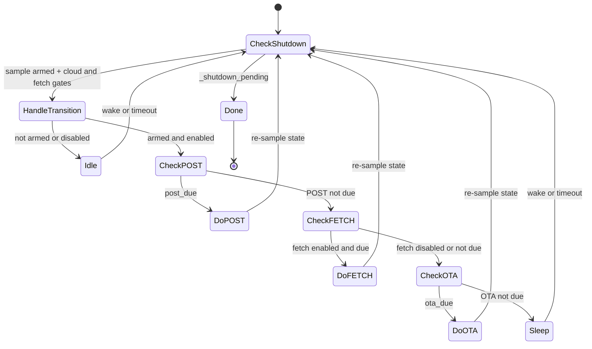

# Cloud Service

Product service that owns the Stationary cloud transport for AirGradient Go:
measurement POST, configuration FETCH, and Wi-Fi OTA availability checks on a
single low-priority task. The
orchestrator owns mode policy and event dispatch; `CloudService` owns the
HTTP cadence and snapshot lifetime. Active only in
`OperatingMode::Stationary` while Wi-Fi is online.

## Files

| File | Purpose |
|---|---|
| `products/go/main/go_cloud.h` | `CloudService` class declaration, `Deps` and `Config` structs |
| `products/go/main/go_cloud.cpp` | Task body, deadline math, snapshot mutex, `AgClient` calls, event posting |
| `products/go/main/go_cloud_types.h` | Fixed cloud result and correction-update payloads shared with `go_events.h` |

## Dependencies

| Dependency | Source | Usage |
|---|---|---|
| `AgClient` | `airgradient-client` (`services/ag_client.h`) | `http_post_measures()`, `http_fetch_config()` |
| `WifiService` | product (`go_wifi.h`) | `rssi()` at post time |
| `OtaService` | product (`go_ota.h`) | `check_wifi_update()` availability probe |
| `retained_uptime` | `airgradient-common` (`retained_uptime.h`) | Retained whole-minute uptime sampled at POST time |
| `Event`, `EventType` | product (`go_events.h`) | Posts `PostMeasuresResult`, `FetchConfigResult`, and `WifiOtaAvailable` |
| `RTOS` | `airgradient-common` (`rtos.h`) | Task create/delete, mutex, semaphore, queue send, notify, time |
| `GoBoard::ag_client()` | product (`go_board.h`) | Lazy accessor; runs `AgClient::begin(serial, Wifi)` on first call |

## Public API

`CloudService` is constructed once by `GoApp` at boot and stays alive for
the process lifetime. All action methods are safe to call from the
orchestrator task at any time, including before `start()` or after `stop()`.

| Method | Purpose |
|---|---|
| `CloudService(queue, deps, cfg)` | Construct with event queue, borrowed `AgClient`, `WifiService`, and `OtaService`, and cadence config. No heap claimed. |
| `start()` | Allocate fetch buffer + semaphore, spawn task. Idempotent. Returns false on failure (self-cleans). |
| `stop()` | Drain in-flight HTTP, delete task, free heap. Bounded by ~15 s. Idempotent. |
| `arm(fire_now)` | Enable periodic ticks. `fire_now` makes the first cycle immediate (consumed on Disarmed→Armed transition only). |
| `disarm()` | Disable periodic requests; in-flight HTTP still drains. |
| `set_disable_cloud(disable)` | Push the `disable_cloud` flag; sampled on the next iteration. |
| `set_config_fetch_enabled(enabled)` | Gate config FETCH independently of POST. Enabling while armed and cloud-enabled makes FETCH immediately due without changing POST cadence. |
| `update_measures_snapshot(m)` | Replace the cached `MeasuresAGo` under a mutex (~µs hold). |

See [`go_cloud.h`](../main/go_cloud.h) for full signatures.

## Config

| Field | Default | Notes |
|---|---|---|
| `post_interval_ms` | `60'000` | POST cadence (start-anchored) |
| `fetch_interval_ms` | `60'000` | FETCH cadence (start-anchored) |
| `ota_check_interval_ms` | `3'600'000` | OTA availability cadence; first check due at task startup |
| `disable_cloud` | `false` | Initial value; runtime changes via `set_disable_cloud()` |
| `config_fetch_enabled` | `true` | Initial independent FETCH gate; runtime follows `configuration_control != Local` |

The Go product selects `CONFIG_AG_DEVICE_MODEL_GO`, so configuration FETCH
requests use
`https://hw.airgradient.com/sensors/airgradient:<serial>/go/config`. The
measurement POST route remains model-independent.

File-local constants in `go_cloud.cpp`:

| Constant | Value | Notes |
|---|---|---|
| `CLOUD_TASK_STACK_SIZE` | `8192` | Task stack from heap (only while running) |
| `CLOUD_TASK_PRIORITY` | `4` | Below SensorProducer (5), above GpsService (3) |
| `FETCH_BUFFER_BYTES` | `2048` | Heap-allocated fetch response buffer, including the terminating NUL |

## Behavior

### Heap Lifecycle

The constructor claims only the small object footprint (atomics, snapshot
member, mutex). Real heap is deferred to `start()`:

- **`start()`** — allocates 8 KB task stack + 2 KB fetch buffer +
  semaphore. Called by the orchestrator only after Wi-Fi is online.
- **`stop()`** — frees all heap; returns to boot-time footprint.
- Portable / Offline modes never call `start()`.

### Task Loop

Due requests run one at a time in POST, FETCH, OTA order. After each request,
the loop rechecks arming and configuration gates before starting the next.
This keeps the availability probe from overlapping cloud TLS requests.

`disable_cloud` suppresses POST, FETCH, and OTA availability checks.
`config_fetch_enabled` affects only FETCH, so `ConfigurationControl::Local`
stops cloud configuration changes while POST and OTA checks continue. Enabling
FETCH sets its deadline to the current time and wakes the task. While the task
is already armed and cloud transport is enabled, the next eligible iteration
fetches immediately without moving `_post_due`. While disarmed, the next
`arm()` establishes the normal schedule. While cloud transport remains
disabled, expired deadlines are moved forward and FETCH resumes on the normal
cadence rather than immediately.

Deadlines are start-anchored: `_post_due = post_started_at + interval`,
not completion time. A 15 s POST leaves 45 s before the next one.

### RSSI Translation

`WIFI_RSSI_INVALID` (0) is translated to `-127` before posting so the
dashboard never sees a misleading 0 dB.

### Uptime Metadata

Every measurement POST includes `boot`, sampled from
`retained_uptime::completed_minutes()` when the POST begins. It is not stored in
the `MeasuresAGo` snapshot, so it advances without new sensor data and remains
independent of measurement validity. The value has the same retained
whole-minute semantics as Local Server: deep-sleep time counts, non-deep-sleep
resets start at `0`, and the wire value saturates at `UINT32_MAX`.

### Shutdown

`stop()` sets the shutdown latch, wakes the task, and waits on the
done-semaphore. After the current request drains, the task acknowledges
shutdown and parks until `stop()` deletes it and frees resources. Worst-case latency is one HTTP
timeout (~15 s).

## Orchestrator Wiring

| Orchestrator method | Cloud action |
|---|---|
| `enter_stationary()` | `set_disable_cloud()` + set first-post latch (no `start()`) |
| `on_wifi_connected()` | Set both runtime gates, then `start()` + `arm(first_post_pending)` |
| `on_wifi_disconnected()` | `disarm()` (except `requested_by_user`) |
| `on_provisioning_connected()` | Set both runtime gates, then `start()` + `arm(true)` after provisioning teardown |
| `change_mode(→ non-Stationary)` | `disarm()` + `stop()` (before `wifi.shutdown()`) |
| Any activated settings candidate | Update `disable_cloud` and/or `configuration_control` runtime gates when changed |
| `on_sensor_data()` | `update_measures_snapshot()` (unconditional, all modes) |
| `on_wifi_ota_available()` | Cloud has already disarmed; run the blocking download if eligible, otherwise re-arm when Stationary and online |
| Committed OTA (`enter_ota()` / `exit_ota()`) | `disarm()` on commit; `arm(false)` on resume when `wifi.is_online()` |

The cloud task is torn down **before** Wi-Fi so in-flight HTTP drains
while the socket is still alive.

### Fetch Configuration Mapping

After a successful complete fetch, the cloud task parses the response body once
and queues a value-only `FetchConfigEventPayload`. Supported fields map into
`GoConfigUpdate` independently. Device behavior fields are:

| Cloud Field | Accepted Values | Go Field |
|---|---|---|
| `pmStandard` | `"ugm3"`, `"us-aqi"` | `pm_use_usaqi` |
| `temperatureUnit` | `"c"`, `"f"` | `use_fahrenheit` |
| `measurementInterval` | Integer 1 .. 3600 | `measure_interval_seconds` (Portable/Stationary; Energy Saving is separate) |
| `gpsMode` | `"off"`, `"tracking"`, `"always"` | `gps_mode` |
| `backLedBrightness` | Integer 0 .. 3 | `back_led_brightness` |
| `touchLedIntensity` | Integer 0 .. 2 | `touch_led_intensity` |
| `buzzerEnabled` | Boolean | `buzzer_enabled` |
| `co2CalibrationRequested` | Boolean | One-shot CO2 calibration request; not persisted |
| `ledTestRequested` | Boolean | One-shot LED diagnostic request; not persisted |
| `gpsTestRequested` | Boolean | One-shot GPS test screen request; not persisted |

Sensor and correction fields are:

| Cloud Field | Accepted Values | Go Field |
|---|---|---|
| `abcDays` | Integer `-1` or 1 .. 200 | `co2_abc_days`; `-1` disables automatic background calibration |
| `tvocLearningOffset` | Integer 1 .. 1000 | `tvoc_learning_offset` |
| `noxLearningOffset` | Integer 1 .. 1000 | `nox_learning_offset` |
| `corrections.pm02` | `none`, `custom_via_pm25_raw`, `factory_calibration` | PM2.5 correction |
| `corrections.atmp` | `none`, `custom` | Temperature correction |
| `corrections.rhum` | `none`, `custom` | Humidity correction |

Each valid scalar or correction sets its own update-mask bit. A malformed field
does not prevent valid siblings from being delivered. Missing fields retain the
active setting, and linear coefficients must be finite JSON numbers with exact
property names. Both linear PM2.5 algorithms require `slr.scalingFactorViaPm25`
and `slr.intercept`; Go ignores `useEpa2021` for both.

Cloud FETCH does not own connectivity or writer authority. The parser ignores
`cloudConnection`/`disableCloudConnection` and `configurationControl`, and the
orchestrator's Cloud-Fetch merge also refuses those update bits. Local,
provisioning, and factory flows retain ownership of those settings.

The orchestrator merges selected fields into a candidate `GoSettings`, commits
and activates it, then asynchronously requests changed ABC periods or gas-index
learning offsets through the producer task. HTTP failures, truncated bodies,
malformed roots, and trailing non-whitespace data produce an empty update mask.

`co2CalibrationRequested: true` queues background CO2 calibration through the
sensor producer. `ledTestRequested: true` then runs the three-second LED
diagnostic. `gpsTestRequested: true` finally opens the live GPS Test screen and
starts its receiver, fast-posting, and TTFF behavior. This ordering lets all
three actions run when one response requests them. A GPS trigger is ignored if
the Peripheral or Accelerometer test is active, and is a no-op if the GPS Test
screen is already open. `false`, a missing field, or a non-boolean value does
nothing. The parser stores the action values directly in
`FetchConfigEventPayload`; they never enter `GoConfigUpdate`, settings, or NVS.
The firmware performs no edge detection because the backend returns `true` once
per request and then returns `false` until another request is made.

Cloud result delivery is best-effort. A full central queue drops the zero-wait
event, so no update is applied; the next periodic FETCH is the next retry
opportunity.

The orchestrator rechecks `configuration_control` when it consumes the result.
If control changes to `Local` while HTTP is in flight, the successful event is
discarded without persistence, runtime changes, calibration, an LED diagnostic,
or GPS Test navigation. Re-enabling Cloud/Both calls
`set_config_fetch_enabled(true)`, making the next FETCH immediately due when the
task is armed and cloud transport is enabled.

### OTA Interaction

The first availability check is due at task startup, after any due POST/FETCH;
subsequent checks use `ota_check_interval_ms`. `OtaService::check_wifi_update()`
uses the firmware endpoint's zero-length probe. No-image and error results are
logged without interrupting normal cloud traffic.

When an image is available, cloud disarms itself after the probe completes and
sends `WifiOtaAvailable`. Its task and buffers stay allocated. The orchestrator
rechecks eligibility and runs the existing blocking download; a non-rebooting
result re-arms cloud when still Stationary and online. A full event queue causes
cloud to re-arm immediately and retry availability at the next scheduled check.
See [orchestrator OTA handling](orchestrator.md#firmware-update-ota).

The handoff uses the existing armed state: a queued reconnect can re-arm cloud
before the OTA event is handled. It is not an exclusive transport lock.

## Events

| EventType | Payload | Producer |
|---|---|---|
| `PostMeasuresResult` | `CloudResultByte` (`AgClientResult`) | Cloud task after each POST |
| `FetchConfigResult` | `FetchConfigEventPayload` | Cloud task after each FETCH |
| `WifiOtaAvailable` | None | Cloud task after an available result and self-disarm |

`PostMeasuresResult` remains result-byte-only. `FetchConfigResult` carries the
result byte, the fixed `GoConfigUpdate`, and transient action-request flags. The
trivially-copyable payload never holds a pointer into the reusable fetch buffer.

## Heap Constraints (ESP32-C5)

The ESP32-C5 has ~183 KB of available heap. The TLS handshake with the
AirGradient backend's 4096-bit RSA certificate temporarily consumes most
of the largest free contiguous block. The Go product's sdkconfig is tuned
for this:

| Setting | Default | Go value | Saving |
|---|---|---|---|
| `CONFIG_MBEDTLS_SSL_IN_CONTENT_LEN` | `16384` | `4096` | 12 KB per TLS connection |
| `CONFIG_ESP_WIFI_DYNAMIC_RX_BUFFER_NUM` | `32` | `16` | Steady-state heap headroom |
| `CONFIG_ESP_WIFI_DYNAMIC_TX_BUFFER_NUM` | `32` | `16` | Steady-state heap headroom |

The 4 KB TLS input buffer is sufficient for the Go product's small
payloads (POST response < 256 bytes, FETCH config < 1 KB). The reduced
Wi-Fi buffers serve the regular POST/FETCH workload plus the hourly OTA probe.

Lifecycle and HTTP paths emit `log_heap()` probes around `start()`,
`stop()`, POST, FETCH, and OTA availability. These probes track whether task
stack allocation and TLS handshakes leave enough contiguous heap for the
Stationary Wi-Fi / provisioning flows.

## Edge Cases / Errors

- **First POST before sensor data.** Default-constructed snapshot has
  every field at invalid sentinels; the serializer omits them while `wifi` and
  `boot` still reach the dashboard.
- **`start()` failure.** Self-cleans on partial allocation failure. The
  orchestrator logs the error; the next `on_wifi_connected()` retries.
- **Reconnect after AP outage.** `disarm()` on disconnect, `arm(false)`
  on reconnect — POST/FETCH resume at the next interval; OTA keeps its deadline.
- **Mode change during in-flight HTTP.** `stop()` drains the call
  (bounded ~15 s), then Wi-Fi shuts down.
- **`set_disable_cloud(true)` while armed.** Expired POST/FETCH deadlines slide
  forward; an overdue OTA probe runs after cloud is re-enabled.
- **Config FETCH disabled while POST is armed.** POST keeps its cadence; the
  disabled FETCH deadline is excluded from wake calculations.
- **Config FETCH re-enabled.** While armed and cloud-enabled, FETCH becomes
  immediately due and POST's deadline is unchanged. A later `arm()` or an
  active cloud-disable gate establishes or preserves normal cadence instead.
- **FETCH result races an authority change.** The cloud task still posts its
  value event; the orchestrator discards it when active control is `Local`.
- **Atomic state before `start()`.** `arm()`, `disarm()`,
  `set_disable_cloud()`, and `set_config_fetch_enabled()` write atomics; the
  values persist and take effect when the task eventually starts.

## Testability

`CloudService` is host-testable via friend-class access
(`CloudServiceTestAccess`) and link-time stubs for `AgClient` (concrete
class, no virtuals), `WifiService`, and `OtaService`. Tests drive the task body
deterministically via `_run_iteration(now)` with injected clock values.

Host tests live in `products/go/tests/go_cloud.tests.cpp` and cover:
transition handling, snapshot round-trip, POST/FETCH forwarding, POST
priority, scalar/correction FETCH mapping, independent FETCH gating,
start-time anchoring, overrun, disarm/disable mid-POST, RSSI translation,
shutdown latch, deadline clamp, first-POST sentinels, and OTA ordering, cadence,
self-disarm, and full-queue recovery.

Orchestrator-level wiring is tested through the stubbed `CloudService` in
`products/go/tests/go_orchestrator.tests.cpp`.
